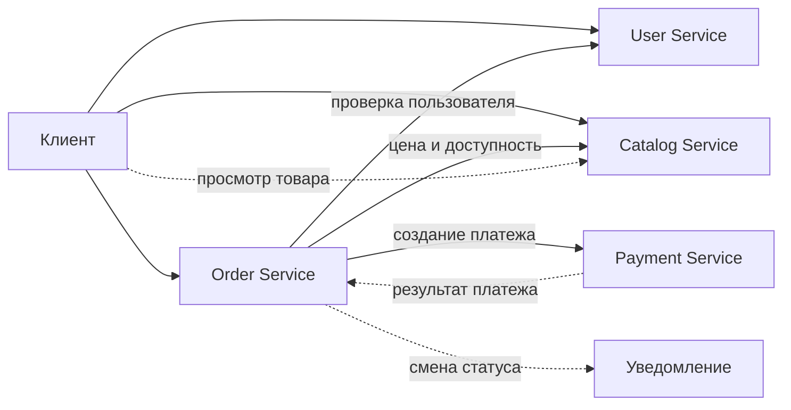

# Архитектура маркетплейса

Для первой версии маркетплейса я остановилась на четырёх сервисах:

| Сервис | За что отвечает |
|---|---|
| **User Service** | покупатели, продавцы, профили пользователей и роли |
| **Catalog Service** | товары, категории, цены, доступность и персональная выдача товаров |
| **Order Service** | оформление заказа, смена статусов и уведомления |
| **Payment Service** | платежи и возвраты |

Сервисов могло быть и больше. Например, персонализацию можно было бы сразу вынести в Recommendation Service, а уведомления — в Notification Service, но пока что это только усложнит нам систему.

Персонализация пока нужна только для выдачи товаров (так пока что сказано в задании)), поэтому логичнее оставить её в Catalog Service. С уведомлениями похожая ситуация: сейчас они отправляются только при изменении заказа, а значит, отдельный сервис для них не нужен.

Если со временем эти части вырастут и у них будет свой собственный независимый сценарий, то мы сможем их вынести в отдельны сервисы без пересмотра всей архитектуры (ура!!)

## Варианты декомпозиции

Перед тем как остановиться на четырёх сервисах, я рассмотрела ещё два варианта. Они не плохие, просто рассчитаны на другой масштаб (ну и стадии продукта).

### Вариант 1. Модульный монолит

Вся система запускается как одно приложение и работает с одной базой, но внутри код разделён на модули пользователей, каталога, заказов и платежей.

Плюсы:

- один процесс проще собирать, запускать и отлаживать
- между модулями нет сетевых вызовов
- транзакции и согласованность данных устроены заметно проще
- для небольшой команды требуется меньше инфраструктуры

Минусы:

- сервис нельзя масштабировать или выпускать независимо от остальных
- одна ошибка способна затронуть весь маркетплейс
- общая база со временем размывает границы между модулями
- платёжная часть и персональные данные оказываются внутри общего контура

Это хороший вариант для быстрого MVP, но он хуже показывает самостоятельные домены и их взаимодействие, что важно в рамках нашего задания

### Вариант 2. Четыре доменных сервиса

Этот вариант я и выбрала

Плюсы:

- границы совпадают с основными бизнес-доменами
- платежи и персональные данные изолированы
- сервисы можно изменять и масштабировать независимо
- четыре сервиса всё ещё можно поддерживать без чрезмерно сложной инфраструктуры

Минусы:

- появляются сетевые ошибки и частичная недоступность
- общей транзакции между заказом и платежом больше нет
- нужны идемпотентность, события, наблюдаемость и обработка повторной доставки
- локальный запуск сложнее, чем у монолита

### Вариант 3. Мелкая микросервисная декомпозиция

Тут отдельно существуют User, Catalog, Inventory, Recommendation, Order, Payment, Notification и Delivery Service.

Плюсы:

- у каждой крупной функции собственный жизненный цикл
- рекомендации, остатки и уведомления можно масштабировать независимо
- небольшие сервисы проще выпускать отдельными командами

Минусы:

- для первой версии получается слишком много процессов, контрактов и точек отказа
- возрастает количество асинхронных сценариев
- сложнее локальная разработка, тестирование и наблюдаемость
- границы некоторых сервисов пока основаны не на реальных требованиях, а на предположениях о будущем

### Почему выбран второй вариант

Четыре доменных сервиса дают разумный баланс. Они покрывают все функции из задания, явно разделяют владельцев данных и при этом не заставляют заранее строить инфраструктуру для восьми отдельных приложений.

Персонализация пока остаётся в Catalog Service: сейчас она влияет только на порядок товаров в выдаче. Уведомления находятся в Order Service, потому что единственный описанный сценарий - сообщить об изменении заказа. Выделять их в самостоятельные сервисы до появления других потребителей нет практического смысла (една, ван сигнал)

Монолит был бы проще в запуске, но хуже демонстрировал бы сервисные границы. Мелкая декомпозиция, наоборот, показала бы больше сервисов, однако добавила бы сложность, которой текущие требования не оправдывают. Поэтому финальным выбран именно вариант с четырьмя сервисами.

## Домены и их распределение по сервисам

Каждый из четырёх доменов размещён в отдельном сервисе. Ниже зафиксировано, где проходит граница каждого домена, за какие данные он отвечает и почему не объединён с соседними.

### User Service

Здесь хранятся пользователи маркетплейса: покупатели и продавцы, их профили и роли

User Service — единственный владелец персональных данных. Остальные сервисы работают с `user_id` и не лезут напрямую в пользовательскую базу. Если им нужна актуальная информация, они запрашивают её через API.

Основные таблицы:

- `users`
- `profiles`
- `roles`
- `user_roles`

Такое ограничение важно не только с точки зрения безопасности. Если формат профиля поменяется, правки останутся внутри одного сервиса и не затронут каталог, заказы или платежи (балдеж)

### Catalog Service

Catalog Service отвечает за всё, что связано с выбором товара:

- товары и категории
- цены
- доступность
- связь товара с продавцом
- персональная выдача

Пример набора таблиц:

- `products`
- `categories`
- `product_views`
- `user_category_preferences`

Для первой версии сложная рекомендательная система не требуется. Достаточно учитывать, какие категории пользователь смотрит чаще всего, историю просмотров и общую популярность товаров. Итоговый порядок можно считать по простой формуле:

```text
score = интерес к категории + популярность товара + свежесть товара
```

Это не полноценная ML-модель, но для старта такой подход понятен, дёшев в поддержке и уже позволяет сделать выдачу немного полезнее.

Ещё один важный момент — цена. Её актуальное значение хранит Catalog Service, однако после оформления заказа цена не должна меняться вслед за каталогом. Поэтому Order Service получает данные о товаре через API и сохраняет их снимок в заказе.

### Order Service

Задача Order Service — провести заказ от создания до завершения. Он хранит сам заказ, его позиции, итоговую стоимость и всю историю изменения статусов.

Основные таблицы могут выглядеть так:

- `orders`
- `order_items`
- `order_status_history`
- `notification_log`

В `order_items` записывается не только `product_id`, но и название товара, количество и цена на момент покупки. Даже если продавец позже переименует товар или изменит его стоимость, старый заказ останется таким, каким его видел покупатель при оформлении.

Для заказа достаточно следующей цепочки статусов:

```text
CREATED -> AWAITING_PAYMENT -> PAID -> PROCESSING -> SHIPPED -> DELIVERED
                  |              |
                  +--------------+-> CANCELLED
```

Статус нельзя менять произвольно. Например, заказ переходит в `PAID` только после подтверждения от Payment Service. Каждое изменение записывается в историю — это пригодится и пользователю, и при разборе спорных ситуаций.

Уведомления пока остаются здесь же. После смены статуса Order Service ставит сообщение на отправку. Ошибка почты или push-провайдера не должна откатывать сам заказ, поэтому уведомление лучше сначала записать в outbox, а затем отправлять отдельно с повторными попытками.

### Payment Service

Payment Service изолирует всю платёжную логику. Он создаёт платёж, обращается к НСПК, хранит результат попытки и при необходимости оформляет возврат.

Внутри сервиса понадобятся примерно такие данные:

- `payments`
- `payment_attempts`
- `refunds`
- `payment_events`

Сам Payment Service не меняет заказ. После обработки платежа он сообщает результат событием `PaymentSucceeded` или `PaymentFailed`, а уже Order Service решает, в какой статус перевести заказ. Это оставляет управление жизненным циклом заказа в одном месте.

Особое внимание нужно уделить повторным запросам. Пользователь может дважды нажать кнопку оплаты, клиент — повторить запрос после тайм-аута, а брокер — повторно доставить сообщение. Поэтому у каждой операции должен быть ключ идемпотентности. Если запрос с таким ключом уже выполнялся, сервис возвращает прежний результат и не пытается списать деньги ещё раз.

Данные банковских карт внутри системы хранить не нужно. От платёжного провайдера достаточно получить токен и идентификатор операции

## Кто владеет данными

У каждого сервиса своё хранилище. Даже если на старте все базы физически находятся на одном сервере, обращаться к чужим таблицам напрямую нельзя, иначе границы быстро станут формальными: любое изменение схемы начнёт ломать сразу несколько сервисов 

| Данные | Владелец | Что остаётся у других |
|---|---|---|
| Пользователь и профиль | User Service | `user_id` |
| Товар, цена и доступность | Catalog Service | `product_id` и снимок товара в заказе |
| Заказ и его статус | Order Service | `order_id` |
| Платёж и возврат | Payment Service | `payment_id` и последний известный статус |

Получается простое правило: читать чужие данные можно только через контракт — API или событие. Менять их имеет право только сервис-владелец.

## Как сервисы общаются

Здесь используются два способа взаимодействия

Если ответ нужен прямо сейчас, сервисы вызывают друг друга по HTTP. Так Order Service проверяет пользователя, получает цену товара и создаёт платёж

События подходят для уже свершившихся фактов. Payment Service не просит заказ "стать оплаченным", а сообщает: платёж успешно завершён. Order Service получает это событие и сам принимает решение о переходе в новый статус.

Основные события:

- `PaymentSucceeded` — платёж прошёл
- `PaymentFailed` — оплатить заказ не удалось
- `OrderStatusChanged` — у заказа изменился статус
- `ProductViewed` — пользователь открыл карточку товара

У каждого события есть собственный `event_id`, время создания и общий `correlation_id` для всей цепочки запросов. Обработчики должны быть идемпотентными: повторная доставка того же события не должна повторно менять состояние системы.

Общая схема получается такой:



Сплошными линиями показаны обычные HTTP-запросы, пунктиром — события и отложенные действия.

## Как проходит оформление заказа

1. Покупатель выбирает товары в каталоге
2. Order Service проверяет пользователя и запрашивает у Catalog Service актуальную цену и доступность каждой позиции
3. Если всё в порядке, создаётся заказ со статусом `CREATED`. Вместе с ним сохраняются снимки товаров (то есть цену на момент покупки, название и тд)
4. Заказ переходит в `AWAITING_PAYMENT`, после чего Order Service просит Payment Service создать платёж
5. Payment Service обращается к платёжному провайдеру
6. При успешной оплате приходит событие `PaymentSucceeded`, и заказ переходит в `PAID`
7. Если оплата не прошла, приходит `PaymentFailed`. Пользователь может попробовать ещё раз, а через заданное время неоплаченный заказ отменяется
8. Изменение статуса записывается в историю, после чего пользователю отправляется уведомление

Общей транзакции на все сервисы здесь нет. Каждый сервис фиксирует только свою часть операции, а дальше система движется с помощью событий. Если цепочка прерывается, выполняется компенсирующее действие. Например, если деньги уже списаны, а заказ пришлось отменить, Payment Service оформляет возврат

## Зафиксированные архитектурные решения

| Решение | Почему так | Чем за это платим |
|---|---|---|
| Разделить систему на четыре доменных сервиса | Границы совпадают с функциями из задания и не создают лишних сервисов | Появляются сетевые вызовы и отдельное развёртывание |
| Выделить базу каждому сервису | Только владелец домена может менять свои данные | Нельзя сделать обычный SQL JOIN между разными доменами |
| Передавать результат платежа событием | Payment Service не получает право менять заказ | Статусы заказа и платежа согласуются не мгновенно |
| Сохранять снимок товара в заказе | История покупки не зависит от будущих изменений каталога | Часть данных намеренно дублируется |
| Оставить персонализацию в Catalog Service | Сейчас она нужна только при построении товарной выдачи | При усложнении модели сервис придётся разделить |
| Оставить уведомления в Order Service | Единственный текущий источник уведомлений — смена статуса заказа | Для новых типов рассылок понадобится отдельный Notification Service |

## Что произойдёт при сбоях

Сетевые ошибки в такой системе неизбежны, поэтому основные сценарии не должны рассчитывать на идеальную связь между сервисами.

Для синхронных запросов нужны тайм-ауты и ограниченное число повторных попыток. Слишком долго повторять запрос бессмысленно: это только увеличит нагрузку на уже недоступный сервис.

События стоит публиковать через Outbox. Тогда изменение данных и запись будущего сообщения происходят в одной локальной транзакции. Даже если брокер в этот момент недоступен, событие не потеряется и будет отправлено позже.

Для наблюдения за системой понадобятся:

- логи изменения заказов и платежей;
- метрики ошибок и времени ответа;
- трассировка запросов по `correlation_id`;
- отдельная очередь для сообщений, которые не удалось обработать после нескольких попыток.

При этом сбой второстепенной функции не должен ломать основной процесс. Неотправленное уведомление можно повторить позже; уже оплаченный заказ из-за него отменять не нужно.

## C4-диаграмма

Исходник контейнерной диаграммы лежит в `diagrams/c4-container.puml`. Для отрисовки используется PlantUML со встроенной библиотекой C4, поэтому отдельно скачивать C4-PlantUML не придётся.

Зависимости для текущей операционной системы устанавливаются одной командой:

```bash
make install
```

Операционную систему Makefile определяет сам. Если автоматическое определение не подходит, можно вызвать нужную цель напрямую:

```bash
make install-macos
make install-linux
make install-windows
```

На macOS нужен Homebrew, на Windows — Chocolatey. Windows-команду лучше запускать из терминала с правами администратора. Linux-цель работает с `apt`, `dnf` и `pacman` и сама использует `sudo`, если команда запущена не от root.

По умолчанию диаграмма собирается в SVG:

```bash
make c4
```

Для PNG есть отдельная команда:

```bash
make c4-png
```

Готовые файлы появятся в `diagrams/out/`. Unix-скрипт находится в `scripts/render-c4.sh`, а версия для Windows — в `scripts/render-c4.ps1`.

## Демонстрационный User Service

В репозитории поднят минимальный User Service на Go. Это только технический каркас: в нём нет пользователей, базы данных и бизнес-операций. Сервис открывает один endpoint — `GET /health`.

### Запуск через Docker Compose

```bash
docker compose up --build -d
curl -i http://localhost:8080/health
```

В ответ должен прийти статус `200 OK`:

```http
HTTP/1.1 200 OK
Content-Type: application/json; charset=utf-8

{"status":"ok","service":"user-service"}
```

В `Dockerfile` также настроен внутренний health-check. Его состояние можно посмотреть так:

```bash
docker compose ps
```

Остановка контейнера:

```bash
docker compose down
```

Те же действия вынесены в Makefile:

```bash
make docker-up
make health
make docker-down
```

Если Docker Compose недоступен, сервис можно запустить обычным Docker:

```bash
docker build -t marketplace-user-service .
docker run --rm -p 8080:8080 marketplace-user-service
```

Для локальной проверки без контейнера нужны только Go и две команды:

```bash
go test ./...
go run ./cmd/user-service
```

### Структура репозитория

```text
.
├── cmd/user-service/       # исходный код и тесты
├── diagrams/               # C4-диаграмма
├── scripts/                # запуск PlantUML на Unix и Windows
├── Dockerfile
├── docker-compose.yml
├── go.mod
├── Makefile
└── README.md
```

## Что можно вынести позже

Текущего разделения достаточно для первой версии. Дальше сервисы стоит выделять только тогда, когда для этого появится практическая причина.

- **Notification Service** понадобится, если уведомления начнут отправлять разные сервисы или появятся отдельные каналы, шаблоны и настройки рассылок.
- **Recommendation Service** имеет смысл при более сложной модели рекомендаций, собственном обучении и отдельной нагрузке.
- **Inventory Service** пригодится, когда простой проверки доступности станет мало и появится резервирование остатков по складам.
- **Delivery Service** можно выделить, если доставка получит собственные статусы, расчёт стоимости и интеграции с перевозчиками.

Пока же эти задачи не требуют отдельных границ. Четыре сервиса закрывают исходные требования и при этом не превращают первую версию проекта в систему, которую сложно запустить и поддерживать.
