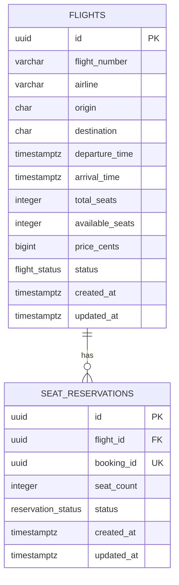
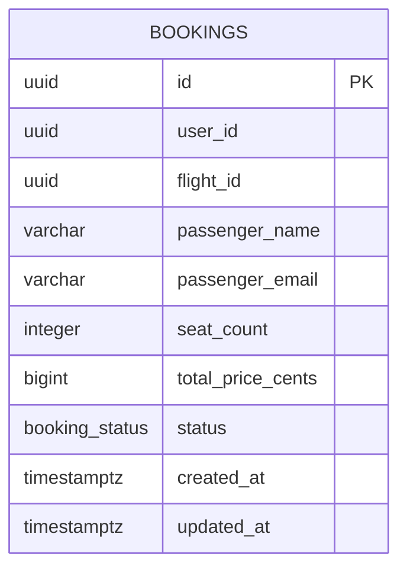

# Схема данных

Сервисы используют разные PostgreSQL. Между `bookings.flight_id` и `flights.id` нет внешнего ключа: таблицы находятся в разных базах, а существование рейса проверяется через gRPC до создания бронирования.

Схема находится в 3NF:

- каждая таблица описывает одну сущность;
- все неключевые поля зависят от первичного ключа целиком;
- резервация не дублирует сведения о рейсе;
- бронирование хранит только идентификатор рейса и снимок итоговой цены, необходимый по бизнес-правилу;
- `booking_id` в `seat_reservations` уникален, поэтому одному бронированию соответствует не более одной резервации.

Ограничения PostgreSQL не допускают отрицательных остатков, нулевой цены, нулевого количества мест, неверных IATA-кодов и прибытия раньше вылета. Пара номера рейса и UTC-даты вылета уникальна через expression index; отдельный дублирующий столбец даты не хранится.

