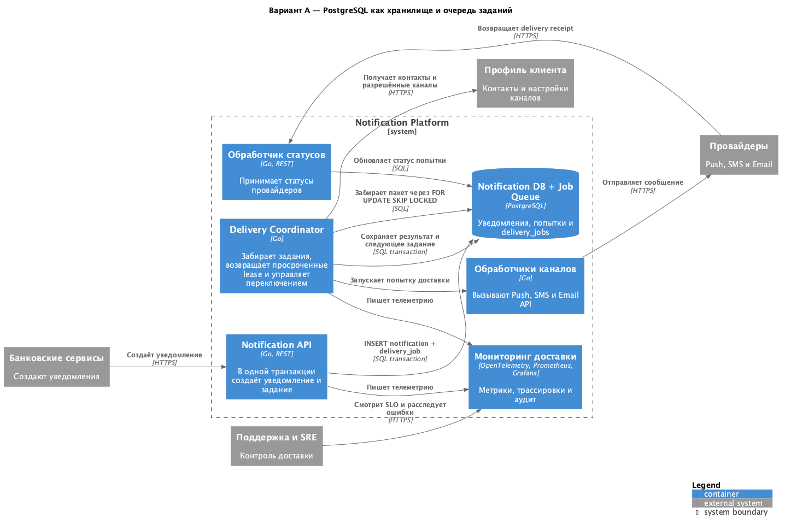
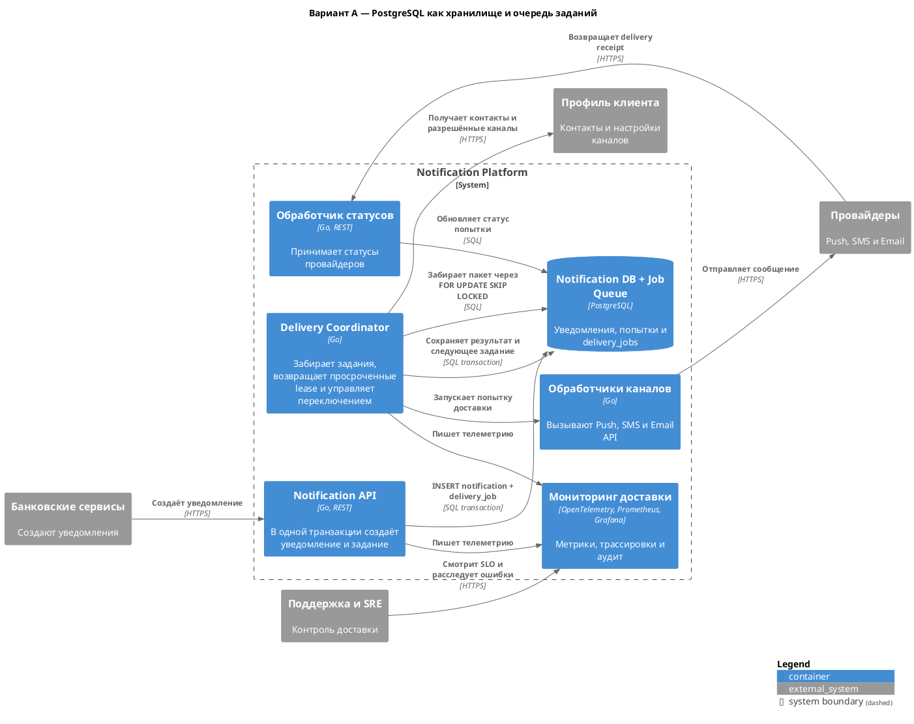
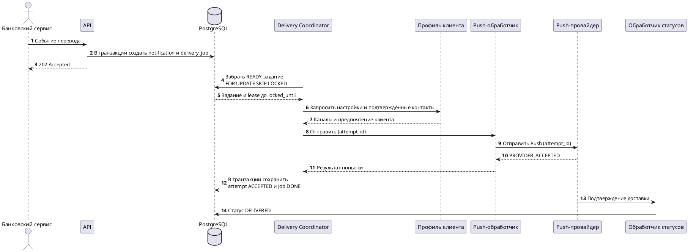
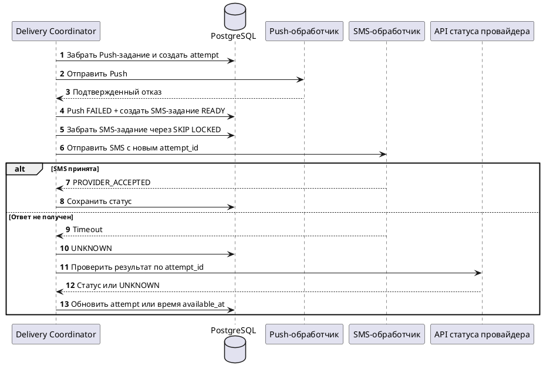
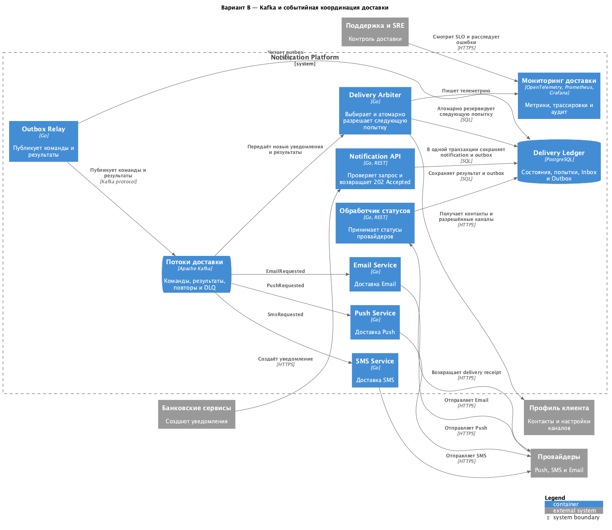
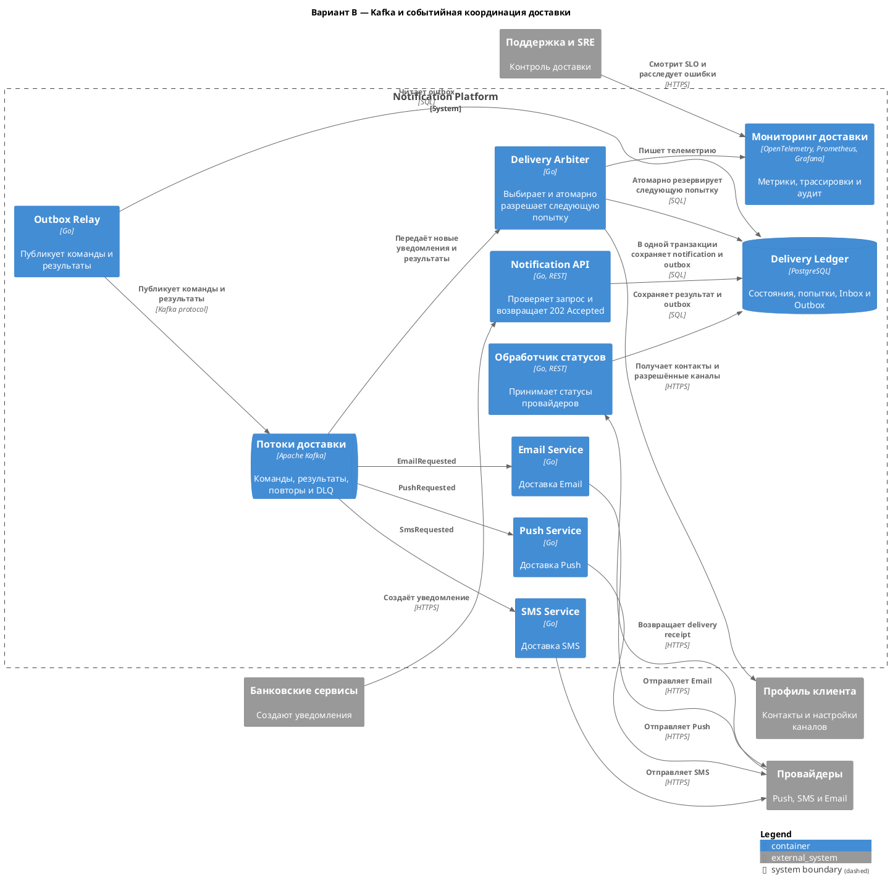
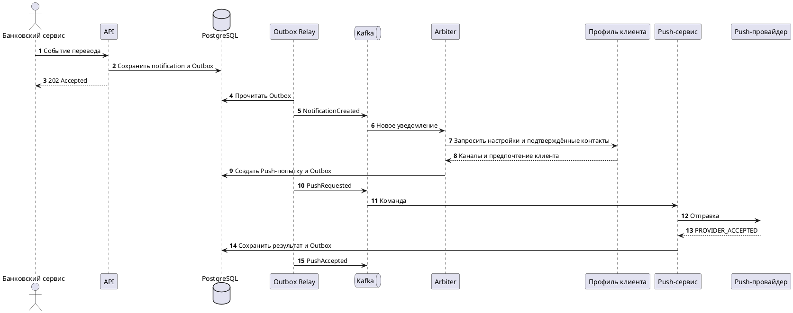
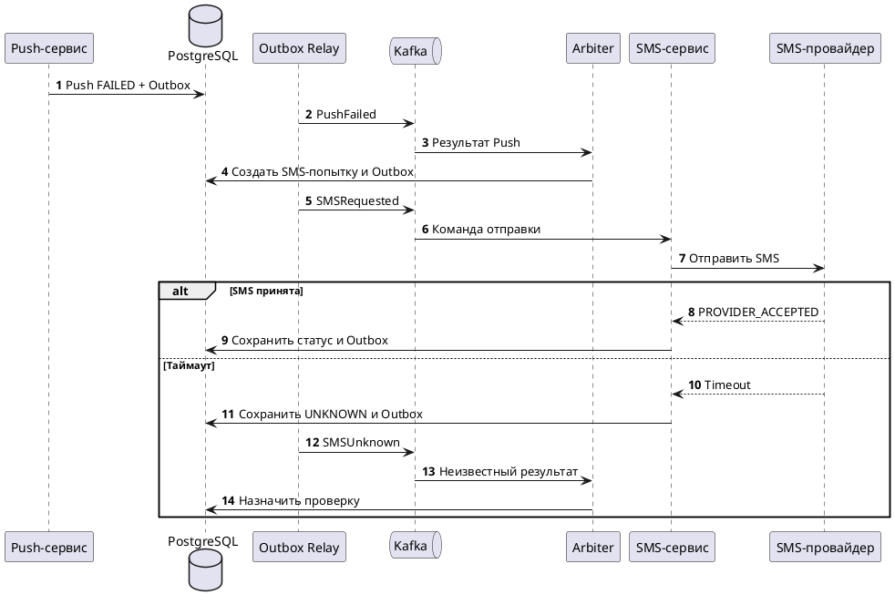

# Домашнее задание №4

## 1. Функциональные требования

| ID | User Story | Функциональное требование | Связь с продуктовой целью |
|---|---|---|---|
| FR1 | Как команда банковского продукта, я хочу передавать уведомления через единый интерфейс, чтобы не реализовывать доставку отдельно в каждом сервисе. | Платформа должна принимать уведомления от всех банковских сервисов через единый интерфейс. | Устраняет разрозненные способы отправки и создаёт единую точку контроля. |
| FR2 | Как владелец платформы, я хочу относить каждое уведомление к транзакционным, сервисным или маркетинговым, чтобы применять подходящие правила срочности и доставки. | Платформа должна определять категорию уведомления и применять правила доставки, соответствующие этой категории. | Критичные сообщения не конкурируют с массовыми кампаниями. |
| FR3 | Как клиент банка, я хочу выбирать предпочтительный канал и отключать необязательные категории, чтобы получать только полезные сообщения удобным способом. | Платформа должна позволять клиенту выбирать предпочтительный канал и отключать сервисные и маркетинговые уведомления. | Снижает число жалоб и отказов от коммуникаций. |
| FR4 | Как клиент банка, я хочу получать обязательные сообщения о движении денег и событиях безопасности даже при отключённом маркетинге, чтобы контролировать операции по счёту. | Платформа должна запускать доставку обязательных уведомлений независимо от настроек сервисных и маркетинговых категорий. | Защищает клиента и критичные банковские сценарии. |
| FR5 | Как клиент банка, я хочу получать одно уведомление на одно событие, чтобы повторная обработка запроса не создавала дубли. | Платформа должна распознавать повтор одного события и не запускать для него независимый процесс доставки. | Напрямую работает на снижение жалоб. |
| FR6 | Как сотрудник поддержки, я хочу видеть статус и историю попыток доставки, чтобы объяснить клиенту, что произошло с уведомлением. | Платформа должна предоставлять текущий статус, историю попыток и причины переключения каналов для каждого уведомления. | Ускоряет расследование жалоб и контроль качества каналов. |
| FR7 | Как менеджер по удержанию, я хочу отправлять разные предложения группам клиентов с разной активностью, чтобы кампании были уместными. | Платформа должна поддерживать маркетинговые кампании для заранее определённых пользовательских сегментов. | Поддерживает рост удержания без одинаковой рассылки всем клиентам. |
| FR8 | Как клиент банка, я хочу получать ограниченное число маркетинговых сообщений в допустимое время, чтобы рассылки не мешали мне. | Перед отправкой маркетингового сообщения платформа должна учитывать лимит частоты и допустимое время коммуникации для клиента. | Снижает риск роста жалоб из-за избыточных контактов. |
| FR9 | Как владелец продукта, я хочу сравнивать доставку и возврат в приложение по кампаниям, чтобы оценивать результат коммуникаций. | Платформа должна предоставлять показатели доставки и возврата в приложение по кампаниям и пользовательским сегментам. | Позволяет контролировать вклад кампаний в удержание. |

## 2. Нефункциональные требования

Обозначение p99 означает: 99% операций завершаются не дольше указанного времени.

| ID          | Нефункциональное требование                                                                                                                                                                            | Обоснование                                                                                                |
| ----------- | ------------------------------------------------------------------------------------------------------------------------------------------------------------------------------------------------------ | ---------------------------------------------------------------------------------------------------------- |
| NFR1  | При штатной нагрузке платформа должна зарегистрировать уведомление и ответить на 99% запросов не позднее чем за 500 мс. | Быстрый ответ не задерживает банковскую операцию. |
| NFR2  | Платформа должна начать первую попытку отправки для 99% критичных уведомлений не позднее чем через 2 секунды после регистрации. | Задаёт измеримый срок для почти мгновенной отправки. |
| NFR3  | Платформа должна получить статус `PROVIDER_ACCEPTED` для 99% критичных уведомлений не позднее чем через 30 секунд. Условие действует, если доступен хотя бы один разрешённый канал и провайдер сообщает достоверный статус. | Проверяет всю цепочку доставки с переключением каналов. Статус провайдера не означает, что клиент прочитал сообщение. |
| NFR4  | Доступность API регистрации уведомлений должна составлять не менее 99,95% за календарный месяц.                                                                                                    | Уведомления являются общей зависимостью многих банковских сервисов.                                        |
| NFR5  | Платформа должна принимать 5 200 новых уведомлений в секунду в течение 10 минут без потери событий. | Проверяет пик нагрузки вместе с кампанией на 1 млн получателей. |
| NFR6  | Во время кампании на 1 млн получателей p99 начала критичной отправки не должен превышать 2 секунды. | Подтверждает, что маркетинг не задерживает критичные сообщения. |
| NFR7  | После ответа `ACCEPTED` платформа не должна терять событие при отказе одного экземпляра приложения или обработчика. Допустимый результат испытания — 0 потерянных событий. | Проверяет сохранность принятого уведомления. Это не гарантия прочтения сообщения клиентом. |
| NFR8  | Повторная обработка одного события не должна создавать новое логическое уведомление. Допустимый результат испытания — 0 внутренних дублей. | Проверяет идемпотентность платформы. Внешний провайдер всё ещё может создать дубль при неизвестном результате. |
| NFR9  | После подтверждённого отказа основного канала платформа должна начать 99% резервных попыток не позднее чем через 5 секунд. | Задаёт измеримый срок переключения канала. |
| NFR10 | Платформа должна сохранять для каждой попытки `notification_id`, `attempt_id`, `trace_id`, канал, время, результат и причину переключения. | Эти данные нужны поддержке, мониторингу и аудиту. |
| NFR11 | Данные должны передаваться по защищённым соединениям. Полный номер карты, PIN, CVV и секреты нельзя сохранять в заданиях, сообщениях брокера и диагностических журналах. | Защищает банковские данные и снижает последствия утечки. |

## 3. Архитектурно значимые требования (ASR)

| ID | ASR | Связанные требования | Почему влияет на архитектуру |
|---|---|---|---|
| ASR1 | Сохранность критичных уведомлений. После ответа `ACCEPTED` событие нельзя потерять. | FR1, FR4, NFR7 | Приём и отправку нужно разделить. Сбой обработчика или провайдера не должен удалять принятое событие. |
| ASR2 | Быстрая критичная доставка. Платформа начинает 99% первых попыток не позднее чем через 2 секунды, в том числе во время массовой кампании. | FR2, FR4, NFR2, NFR5, NFR6 | Критичные и маркетинговые сообщения нельзя обрабатывать в одном общем потоке без изоляции ресурсов. |
| ASR3 | Автоматическое переключение каналов. После подтверждённого отказа резервная попытка начинается не позднее чем через 5 секунд. | FR3, FR4, NFR9 | Платформа должна хранить состояние попытки, отличать отказ от таймаута и выбирать следующий канал. |
| ASR4 | Защита от внутренних дублей. Повтор события или задания не создаёт новое логическое уведомление. | FR5, NFR8 | Отправитель и обработчик могут повторить запрос. Для защиты нужны устойчивые идентификаторы и атомарные переходы состояния. |
| ASR5 | Наблюдаемость доставки. Для каждой попытки сохраняются канал, время, результат и причина переключения. | FR6, NFR10 | Поддержка и SRE должны восстановить полный путь уведомления по одному идентификатору. Для этого нужны единые статусы, метрики и трассировка. |

## 4. Ключевые архитектурные вопросы

| ID | Архитектурный вопрос | Связанные требования и ASR | Почему важен |
|---|---|---|---|
| Q1 | Как передать сохранённое уведомление в фоновую обработку без риска потери? | FR1, NFR7, ASR1 | Сравниваются два способа: задание в PostgreSQL и Outbox с Kafka. |
| Q2 | Когда переключать канал после отказа или таймаута провайдера? | NFR3, NFR9, ASR2–ASR4 | Раннее переключение ускоряет доставку, но повышает риск дубля и стоимость SMS. |
| Q3 | Как защитить критичный поток во время кампании на 1 млн получателей? | NFR5, NFR6, ASR2 | Для критичных сообщений нужны отдельные ресурсы и ограничения маркетингового потока. |
| Q4 | Как восстановить полный путь уведомления при жалобе или сбое? | FR6, NFR10, ASR5 | Все компоненты должны использовать общие идентификаторы, статусы, метрики и трассировку. |

## 5. Архитектурные последствия ASR

| ASR | Архитектурные последствия | Какой компромисс возникает |
|---|---|---|
| ASR1. Сохранность уведомлений | В варианте A платформа одной транзакцией создаёт уведомление и `delivery_job`. В варианте B платформа одной транзакцией создаёт уведомление и Outbox, затем relay публикует событие в Kafka. | Вариант A проще, но увеличивает нагрузку на PostgreSQL. Вариант B сложнее и требует идемпотентных обработчиков. |
| ASR2. Быстрая критичная доставка | Приём отделяется от отправки. Критичные, сервисные и маркетинговые сообщения получают отдельные потоки, квоты и обработчики. | Платформа использует больше ресурсов. Команда должна контролировать возраст самого старого задания. |
| ASR3. Переключение каналов | Платформа хранит состояние каждой попытки, таймеры и порядок каналов. Координатор или арбитр разрешает резервную попытку. | Быстрое переключение повышает стоимость SMS и риск внешнего дубля. |
| ASR4. Защита от дублей | Платформа использует ключ идемпотентности, `notification_id`, `attempt_id`, Inbox и уникальные ограничения. | Таймаут провайдера оставляет результат неизвестным. Полностью исключить внешний дубль в этом случае нельзя. |
| ASR5. Наблюдаемость | Все компоненты передают `notification_id`, `attempt_id` и `trace_id`. Платформа хранит историю статусов и публикует метрики задержки, отказов и переключений. | Возрастает объём журналов и метрик. Для них нужны срок хранения и контроль доступа. |

## 6. Решения, которые не подходят

| Решение | Какой ASR нарушается | Почему не подходит |
|---|---|---|
| Вызывать Push, SMS и Email прямо из API банковского сервиса | ASR1, ASR2, ASR3 | Банковская операция будет ждать внешних провайдеров. После таймаута отправитель не узнает, сохранено ли уведомление. Повтор запроса может создать дубль. |
| Использовать один поток и один пул обработчиков для всех уведомлений | ASR2 | Кампания на 1 млн получателей займёт общий поток. Уведомления о списаниях начнут ждать. |
| Считать Kafka exactly-once гарантией одной SMS | ASR4 | Транзакция Kafka не включает внешний HTTP-вызов. Если провайдер отправил SMS, но ответ потерялся, повтор остаётся возможным. |

## 7. Неопределённости и способы проверки

| Что неизвестно | Почему важно | Как проверить |
|---|---|---|
| Доля Push с подтверждённой доставкой и время подтверждения | Значение определяет задержку перед дорогой SMS | В течение четырёх недель измерять `PROVIDER_ACCEPTED` и `DELIVERED` отдельно по iOS, Android и версиям приложения. |
| Поддержка ключа идемпотентности и запроса статуса у SMS- и Email-провайдеров | Без этих функций растёт риск дубля после таймаута | Повторить один `attempt_id`, потерять ответ провайдера и запросить итоговый статус. |
| Фактический пик новых уведомлений | Завышенная оценка увеличит стоимость. Заниженная оценка создаст очередь. | Измерить почасовые перцентили нагрузки и провести тест на 5 200 уведомлений/с с повторными попытками. |
| Порядок Push, SMS и Email | Ранний SMS ускоряет доставку, но повышает стоимость. | Сравнить маршруты Push → SMS и Push → Email → SMS. Измерить p99, доставку, жалобы и стоимость успешной отправки. |

# RFC: Доставка критичных уведомлений с автоматическим переключением каналов

| Метаданные | Значение |
|---|---|
| Статус | DESIGN |
| Автор(ы) | [ФИО] |
| Ответственный | [ФИО] |
| Бизнес-заказчик | [ФИО] |
| Ревьюеры | [ФИО, дата] |
| Дата создания | 2026-11-17 |
| Дата обновления | 2026-11-17 |

## Оглавление

1. [Контекст](#1-контекст)
2. [Продуктовый анализ](#2-продуктовый-анализ)
3. [Пользовательские сценарии](#3-пользовательские-сценарии)
4. [Статистика](#4-статистика)
5. [Требования](#5-требования)
6. [Варианты решения](#6-варианты-решения)
7. [Сравнительный анализ](#7-сравнительный-анализ)
8. [Выводы](#8-выводы)
9. [Связанные задачи](#9-связанные-задачи)
10. [Приложения](#приложения)

---

## 1. Контекст

Сейчас каждая банковская команда отправляет уведомления самостоятельно. Подходы различаются. В результате сообщения задерживаются, повторяются или теряются при сбое провайдера.

Notification Platform принимает все уведомления банка. Сначала платформа сохраняет запрос. Затем она отправляет сообщение через Push, SMS или Email. Исходный банковский сервис не ждёт завершения доставки.

RFC сравнивает два способа фоновой обработки: очередь заданий в PostgreSQL и событийную координацию через Kafka. Ключевая проблема — момент переключения канала. Если SMS-провайдер не ответил, SMS могла быть отправлена. Немедленный повтор может создать дубль.

## 2. Продуктовый анализ

Платформа решает три бизнес-задачи:

| Цель | Что делаем |
|---|---|
| Удержание клиентов +15% | Разделить клиентов по активности. Использовать отдельный сценарий для каждого сегмента. |
| Жалобы −30% | Учитывать настройки клиента. Ограничивать маркетинг. Не создавать внутренние дубли. |
| Надёжная критичная доставка | Сохранять принятое событие. Переключать канал после подтверждённого отказа. |

Основной предмет RFC — критичная доставка. Массовая кампания не должна задерживать уведомления о движении денег и событиях безопасности.

Удержание и жалобы измеряются относительно согласованного базового периода. Для оценки удержания используются контрольные группы по сегментам. Возврат клиента после Push не доказывает влияние кампании. Жалобы считаются на 100 тыс. доставленных уведомлений.

Базовый порядок критичной доставки: Push → SMS → Email. Канал используется только при наличии подтверждённого контакта. Ограничения частоты маркетинга к критичным сообщениям не применяются.

Гарантия относится к процессу доставки. После статуса `ACCEPTED` платформа сохраняет уведомление и продолжает попытки. Процесс завершается статусом `PROVIDER_ACCEPTED` или `EXHAUSTED`. Платформа не гарантирует, что устройство включено, контакт актуален или клиент прочитал сообщение.

Клиент не может полностью отключить уведомления о движении денег и безопасности. Он может выбрать предпочтительный канал. После отказа этого канала платформа использует резервный подтверждённый контакт. Сервисные и маркетинговые уведомления можно отключить.

## 3. Пользовательские сценарии

| Приоритет | Тип сценария | Действующее лицо | Сценарий |
|---|---|---|---|
| MUST HAVE | Обычная доставка | Клиент | После перевода получает Push с подтверждением операции. |
| MUST HAVE | Переключение канала | Клиент | Если Push не доставлен, система пытается отправить SMS. |
| MUST HAVE | Повтор события | Банковский сервис | Повторно передает событие без создания второго уведомления. |
| MUST HAVE | Восстановление | Платформа | Продолжает отправку после перезапуска обработчика. |
| MUST HAVE | Неизвестный результат | Платформа | После таймаута проверяет результат отправки, прежде чем повторять ее. |
| SHOULD HAVE | Контроль доставки | Служба поддержки | Видит историю попыток и причины переключения каналов. |

## 4. Статистика

Исходный масштаб: 10 млн MAU, 3 млн DAU и до 300 тыс. клиентов одновременно. Число активных клиентов не равно потоку уведомлений. Поэтому RPS рассчитывается по числу сообщений в сутки. Значение 300 тыс. используется для оценки всплесков после массовых событий.

| Показатель | Расчет | Нагрузка |
|---|---|---|
| Критичные за сутки | 3 млн × 2 | 6 млн |
| Сервисные за сутки | 3 млн × 3 | 9 млн |
| Маркетинговые за сутки | 3 млн × 5 | 15 млн |
| Всего за сутки | 6 млн + 9 млн + 15 млн | 30 млн |
| Средняя нагрузка | 30 млн / 86 400 | ≈347 уведомлений/с |
| Пиковая нагрузка | 347 × 10 | ≈3 470/с |
| Кампания на 1 млн за 10 минут | 1 млн / 600 | ≈1 670/с |
| Общий стресс-сценарий | 3 470 + 1 670 | ≈5 140/с |

Расчётная цель — 5 200 новых уведомлений в секунду.

Допущения: пик равен десятикратному среднему потоку; кампания длится 10 минут. Расчёт частично учитывает маркетинговые сообщения дважды. Такой запас используется для стресс-теста.

Средний критичный поток — 69 уведомлений в секунду. Расчётный пик — 694 уведомления в секунду. Основной риск возникает при одновременной массовой кампании.

Если 5% критичных уведомлений переходят на SMS, банк отправляет 300 тыс. SMS в сутки. При доле 20% объём вырастает до 1,2 млн SMS. Раннее переключение на SMS может добавить 900 тыс. платных сообщений в сутки.

## 5. Требования

### Функциональные требования RFC

| ID | Приоритет | Требование | Основа |
|---|---|---|---|
| R-FR1 | MUST HAVE | Принимать и сохранять критичные уведомления от банковских сервисов. | FR1, FR4 |
| R-FR2 | MUST HAVE | Выбирать доступный канал с учётом типа уведомления и пользовательских настроек. | FR2–FR4 |
| R-FR3 | MUST HAVE | Автоматически переключаться на резервный канал после отказа основного. | ASR3, условие RFC |
| R-FR4 | MUST HAVE | Не создавать повторные уведомления при повторном событии. | FR5 |
| R-FR5 | MUST HAVE | Сохранять историю отправок и причины отказов. | FR6 |
| R-FR6 | MUST HAVE | Продолжать обработку принятых сообщений после сбоя. | ASR1 |

### Нефункциональные требования RFC

| ID | Приоритет | Требование |
|---|---|---|
| R-NFR1 | MUST HAVE | p99 регистрации уведомления ≤500 мс при штатной нагрузке. |
| R-NFR2 | MUST HAVE | p99 начала первой критичной отправки ≤2 с, в том числе при массовой кампании. |
| R-NFR3 | MUST HAVE | p99 начала резервной попытки ≤5 с после подтверждённого отказа основного канала. |
| R-NFR4 | MUST HAVE | p99 получения `PROVIDER_ACCEPTED` ≤30 с, если доступен хотя бы один разрешённый канал и провайдер возвращает достоверный статус. |
| R-NFR5 | MUST HAVE | 0 потерянных подтверждённо принятых событий при тестовом отказе одного обработчика. |
| R-NFR6 | MUST HAVE | 0 повторных логических отправок при повторной обработке одного события. |
| R-NFR7 | MUST HAVE | Обработка стресс-нагрузки 5 200 новых уведомлений/с в течение 10 минут без потери принятых событий. |
| R-NFR8 | MUST HAVE | Для каждой попытки сохраняются `notification_id`, `attempt_id`, `trace_id`, канал, время, результат и причина переключения. Платформа публикует метрики задержки, ошибок и переключений. |
| R-NFR9 | MUST HAVE | Критичные, сервисные и маркетинговые сообщения используют отдельные потоки, квоты и пулы обработчиков. Кампания не должна повышать p99 начала критичной попытки выше 2 секунд. |
| R-NFR10 | MUST HAVE | Данные передаются по TLS. PIN, CVV, полный номер карты и секреты не сохраняются в содержимом сообщения, заданиях, брокере и журналах. |
| R-NFR11 | MUST HAVE | Доступность API регистрации критичных уведомлений должна составлять не менее 99,95% за календарный месяц. |

Численные SLA проверяются нагрузочными и отказоустойчивыми тестами.

### Политика переключения каналов

1. Платформа выбирает предпочтительный доступный канал клиента. Если предпочтение не задано, действует порядок Push → SMS → Email.
2. После постоянного отказа платформа сразу выбирает следующий канал.
3. После временной ошибки платформа повторяет попытку ограниченное число раз. Интервал между попытками увеличивается и содержит случайную задержку.
4. После таймаута платформа записывает статус `UNKNOWN`. Затем она запрашивает результат по `attempt_id` и ждёт не более 5 секунд. Если результат остаётся неизвестным, платформа запускает резервный канал и отмечает риск внешнего дубля.
5. После статуса `PROVIDER_ACCEPTED` платформа останавливает новые попытки. Поздний противоречивый обратный статус передаётся на сверку.
6. После исчерпания каналов или общего срока платформа присваивает статус `EXHAUSTED`. Система создаёт оповещение и задачу на разбор.

### ASR и приоритеты

| ASR | Приоритет | Что определяет |
|---|---|---|
| ASR1. Сохранность уведомлений | P0 | Как не терять принятые события. |
| ASR2. Скорость критичной доставки | P0 | Как обеспечить отправку без задержек от других рассылок. |
| ASR3. Автоматическое переключение | P0 | Как и когда переключаться между каналами. |
| ASR4. Отсутствие внутренних дублей | P0 | Как контролировать повторную обработку. |
| ASR5. Наблюдаемость доставки | P0 | Как восстановить путь уведомления и причину переключения. |

P0 — обязательное требование подсистемы доставки.

---

## 6. Варианты решения

### Вариант A. PostgreSQL как хранилище и очередь заданий

#### Принцип работы

Отдельного брокера нет. Notification API одной транзакцией создаёт уведомление и строку в `delivery_jobs`. Delivery Coordinator забирает готовые задания через `FOR UPDATE SKIP LOCKED`. Каждое занятое задание получает временную блокировку — lease. Если обработчик остановился, Coordinator возвращает задание в статус `READY` после окончания `locked_until`.

#### Технологии

PostgreSQL в конфигурации высокой доступности, PgBouncer, Go, REST/HTTP, OpenTelemetry, Prometheus, Grafana, FCM/APNs, SMS- и Email-провайдеры. C4 показывает PostgreSQL как один логический контейнер.

Таблица `delivery_jobs` хранит `lane`, `status`, `available_at`, `locked_until`, `worker_id` и `attempt_id`. Частичный индекс ускоряет поиск готовых заданий. Транзакция получения задания завершается до обращения к провайдеру. Блокировку PostgreSQL нельзя удерживать во время отправки Push или SMS. Результат записывается отдельной короткой транзакцией.

#### Архитектура C4 Container

Исходник диаграммы: [variant-a-c4.puml](diagrams/variant-a-c4.puml).

#### Основной сценарий

#### Сценарий переключения канала

#### Выполнение ASR

| ASR | Механизм |
|---|---|
| ASR1. Сохранность | `notification` и `delivery_job` создаются одной транзакцией. Lease возвращает зависшее задание в обработку. |
| ASR2. Скорость | Частичный индекс ускоряет поиск критичных заданий. Критичный поток использует отдельный пул обработчиков. |
| ASR3. Переключение каналов | Coordinator хранит состояние доставки и разрешает следующий канал. |
| ASR4. Дубли | Платформа использует входной ключ идемпотентности, уникальные `notification_id` и `attempt_id`, а также атомарные переходы состояния. |
| ASR5. Наблюдаемость | PostgreSQL хранит историю попыток. Все записи содержат `notification_id`, `attempt_id` и `trace_id`. |

#### Преимущества

- Уведомление и задание создаются атомарно без Outbox.
- Все состояния одного уведомления находятся в PostgreSQL.
- Для запуска требуется меньше инфраструктуры.
- Небольшой команде проще сопровождать решение.

#### Ограничения

- PostgreSQL одновременно обслуживает API, историю и очередь.
- Опрос таблицы, частые `UPDATE` и очистка завершённых заданий создают нагрузку и раздувают таблицу.
- Нужны секционирование, частичные индексы, пакетное получение заданий, PgBouncer и архивирование.
- Изоляция критичных сообщений от маркетинга слабее, чем в Kafka.
- Пропускную способность 5 200 уведомлений/с нужно подтвердить нагрузочным тестом.

#### Этапы реализации

| Этап | Содержание | Срок | Ресурсы | Риск |
|---|---|---|---|---|
| 1 | Таблицы `notification`, `attempt`, `delivery_jobs` и API | 1,5 недели | Backend-разработчик | Конкуренция за строки, ошибочные индексы |
| 2 | Coordinator, lease, повторы и переключение каналов | 2,5 недели | Backend-разработчик | Повторная отправка после окончания lease |
| 3 | Секционирование, мониторинг и нагрузочные тесты | 2 недели | Backend, QA, SRE/DBA | PostgreSQL не выдержит расчётный пик |

### Вариант B. Kafka и событийная координация

#### Принцип работы

Push, SMS и Email обслуживают отдельные сервисы. Каждый сервис отправляет сообщение и публикует результат в Kafka. Delivery Arbiter получает результаты и разрешает следующую попытку. Арбитр обязателен: без него несколько сервисов могут одновременно запустить резервную отправку.

#### Технологии

Apache Kafka с тремя и более брокерами, PostgreSQL в конфигурации высокой доступности, Go, REST/HTTP, отдельные сервисы Push, SMS и Email. C4 показывает кластеры Kafka и PostgreSQL как логические контейнеры.

#### Архитектура C4 Container

Исходник диаграммы: [variant-b-c4.puml](diagrams/variant-b-c4.puml).

#### Основной сценарий

#### Сценарий переключения канала

#### Преимущества

- Сервисы каналов разрабатываются и масштабируются независимо.
- Сбой одного канала не останавливает остальные каналы.
- Kafka хранит историю событий для повторной обработки и аналитики.
- Отдельные топики и группы потребителей изолируют критичный поток.

#### Ограничения

- Команда сопровождает больше компонентов и контрактов событий.
- Для повторов нужен планировщик или отдельные топики повторов.
- Запоздалые результаты усложняют переходы состояния.
- Delivery Arbiter остаётся критичным компонентом.

#### Выполнение ASR

| ASR | Механизм |
|---|---|
| ASR1. Сохранность | PostgreSQL и Outbox сохраняют событие до публикации. Kafka использует `acks=all`, replication factor 3 и `min.insync.replicas=2`. |
| ASR2. Скорость | Критичные сообщения используют отдельные топики, группы потребителей, квоты и зарезервированную мощность. |
| ASR3. Переключение каналов | Arbiter получает результат канала и через Outbox публикует команду для следующего канала. |
| ASR4. Дубли | Сообщения разделяются по `notification_id`. Inbox и уникальный `attempt_id` блокируют повторную внутреннюю обработку. Kafka EOS не охватывает API провайдера. |
| ASR5. Наблюдаемость | Kafka хранит события доставки. PostgreSQL хранит текущий статус и историю попыток. Все компоненты передают `trace_id`. |

#### Этапы реализации

| Этап | Содержание | Срок | Ресурсы | Риск |
|---|---|---|---|---|
| 1 | API, PostgreSQL, Kafka, контракты событий | 2 недели | Backend | Ошибки в контрактах |
| 2 | Arbiter и сервисы каналов | 4 недели | Backend | Гонки при переключении |
| 3 | Проверка отказов, мониторинг и нагрузка | 3 недели | Backend, QA, SRE | Сложность диагностики |

Оценка сроков действует при наличии готовых кластеров Kafka и PostgreSQL.

---

## 7. Сравнительный анализ

### Соответствие ASR

| ASR | Вариант A | Вариант B |
|---|---|---|
| ASR1. Сохранность | Уведомление и задание создаются одной транзакцией PostgreSQL | PostgreSQL сохраняет уведомление и Outbox; Kafka хранит опубликованное событие |
| ASR2. Скорость | Компонентов меньше, но все обработчики конкурируют за PostgreSQL | Отдельные топики и группы потребителей лучше изолируют нагрузку |
| ASR3. Переключение | Решение принимает Coordinator | Решение принимает Arbiter |
| ASR4. Дубли | ID уведомления и атомарное резервирование попытки | ID команды и атомарное резервирование попытки |
| ASR5. Наблюдаемость | История попыток и статусов в PostgreSQL | История в PostgreSQL и события Kafka |

Фактическое соблюдение SLA для обоих вариантов проверяется нагрузочными и отказоустойчивыми тестами.

### Соответствие требованиям RFC

| Требование | Вариант A: PostgreSQL | Вариант B: Kafka |
|---|---|---|
| R-FR1. Приём и сохранение | ✅ Уведомление и задание в одной транзакции | ✅ PostgreSQL + Outbox |
| R-FR3. Автоматическое переключение | ✅ Coordinator | ✅ Arbiter и события результата |
| R-FR4. Защита от повторного события | ✅ Уникальные ограничения и атомарные переходы | ✅ Inbox и уникальные ограничения |
| R-FR5. История попыток | ✅ PostgreSQL | ✅ Delivery Ledger и события |
| R-NFR2. Первая попытка ≤2 с | ✅ Проверяется нагрузочным тестом | ✅ Проверяется нагрузочным тестом |
| R-NFR5. Нет потерь после приёма | ✅ Транзакция, lease и повторное получение задания | ✅ Репликация Kafka и Outbox |
| R-NFR6. Нет внутренних дублей | ✅ `notification_id` и `attempt_id` | ✅ `notification_id` и `attempt_id` |
| R-NFR9. Изоляция критичного потока | ⚠️ Отдельные линии и обработчики используют общие ресурсы БД | ✅ Отдельные топики, квоты и группы потребителей |

### Ресурсы и компромиссы

| Критерий | A. PostgreSQL + Coordinator | B. Kafka + Arbiter |
|---|---|---|
| Основная модель | Таблица `delivery_jobs` работает как очередь | Kafka хранит журнал событий для независимых потребителей |
| Повторы | `available_at`, lease и восстановление просроченных заданий | Топики повторов или планировщик |
| Изоляция нагрузки | Потоки разделены логически, но используют общие ресурсы PostgreSQL | Топики и квоты разделяют ресурсы точнее |
| Повторное чтение | Доступно, пока данные находятся в рабочих таблицах или архиве | Kafka хранит события для повторного чтения |
| Предварительный срок | ≈6 недель | ≈9 недель |
| Команда | 2 Backend + QA/SRE/DBA | 2–3 Backend + QA/SRE |
| Изменение каналов | Выполняется через общий Coordinator | Сервисы каналов развиваются независимо |
| Отладка переключения | Проще проследить по состоянию в БД | Нужно сопоставлять больше событий |
| Эксплуатационная цена | Ниже на старте, но растёт вместе с нагрузкой на БД | Выше без готовой Kafka-платформы |
| Главный риск | Горячая таблица, её разрастание, частый опрос и конкуренция соединений | Сложность повторов, схем событий и эксплуатации Kafka |
| Когда выбирать | Быстрый запуск, умеренная нагрузка, небольшая команда | Большой поток, строгая изоляция и готовая Kafka-платформа |

## 8. Выводы

Рекомендуемый вариант: Kafka + PostgreSQL + Delivery Arbiter.

Вариант с PostgreSQL проще. Он одной транзакцией создаёт уведомление и задание. Для запуска требуется меньше инфраструктуры. Этот вариант подходит для первой версии при умеренной нагрузке и для проверочного прототипа.

Расчётная нагрузка достигает 30 млн уведомлений в сутки и 5 200 новых уведомлений в секунду. Kafka лучше отделяет критичные сообщения от маркетинга. Группы потребителей масштабируются независимо. События остаются доступными для повторной обработки и аналитики. Поэтому Kafka выбрана для целевой архитектуры. Условие выбора — в банке есть поддерживаемая Kafka-платформа.

Компромиссы и ограничения:

- Нужно реализовать Arbiter, механизм отложенных повторов и сверку неизвестных результатов.
- Если все каналы недоступны, нельзя гарантировать фактическую доставку пользователю.
- Если провайдер не ответил, нельзя сразу считать сообщение недоставленным: повтор может создать дубль.
- Чем раньше переключаемся на SMS, тем выше шанс быстрой доставки, но больше расходы.
- PostgreSQL и Kafka требуют высокой доступности, резервного копирования, мониторинга и операционной экспертизы.

После статуса `ACCEPTED` решение сохраняет событие и продолжает попытки по заданной политике. Статус успешной доставки присваивается только при наличии доступного канала и достоверного ответа провайдера.

## 9. Связанные задачи

| Задача | Приоритет |
|---|---|
| Согласовать обязательные типы уведомлений и настройки каналов | MUST HAVE |
| Реализовать PostgreSQL, Outbox, Kafka и контроль дублей для целевого варианта | MUST HAVE |
| Провести нагрузочный прототип очереди заданий в PostgreSQL | SHOULD HAVE |
| Подключить Push, SMS и Email с обработкой статусов | MUST HAVE |
| Проверить переключение каналов, нагрузку и восстановление после сбоев | MUST HAVE |
| Настроить контроль частоты маркетинга и аналитику удержания | SHOULD HAVE |

## Приложения

### Глоссарий

| Термин | Значение |
|---|---|
| Failover | Переход на резервный канал после отказа основного |
| Outbox | Запись для надёжной последующей публикации события |
| Lease | Ограниченное по времени право обработчика выполнять конкретное задание |
| SKIP LOCKED | Режим PostgreSQL, в котором параллельный обработчик пропускает уже занятые строки |
| Delivery Coordinator | Сервис, который управляет последовательностью попыток и переключением каналов |
| Arbiter | Сервис, который разрешает следующую попытку после получения результата предыдущей |
| Топик Kafka | Именованный поток событий в Kafka |
| Группа потребителей | Набор обработчиков, которые совместно читают один поток событий |
| Идемпотентность | Повтор операции не создаёт новый логический результат |
| Callback | Обратный запрос провайдера со статусом доставки |
| ACCEPTED | Платформа сохранила уведомление и приняла ответственность за дальнейшие попытки |
| PROVIDER_ACCEPTED | Провайдер принял запрос на отправку сообщения |
| DELIVERED | Провайдер подтвердил доставку, если канал поддерживает такой статус |
| UNKNOWN | Состояние, когда неизвестно, выполнил ли провайдер отправку |
| EXHAUSTED | Разрешённые каналы или общий срок доставки исчерпаны |
